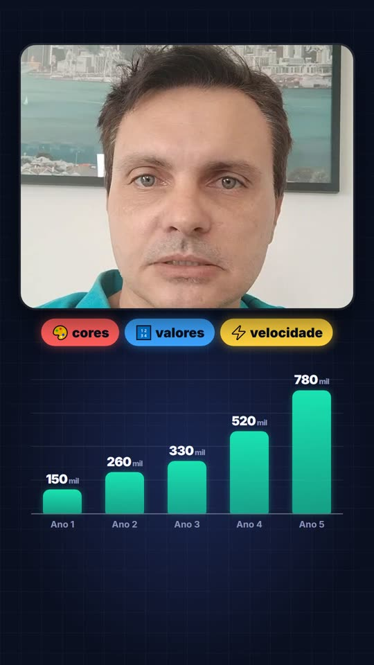
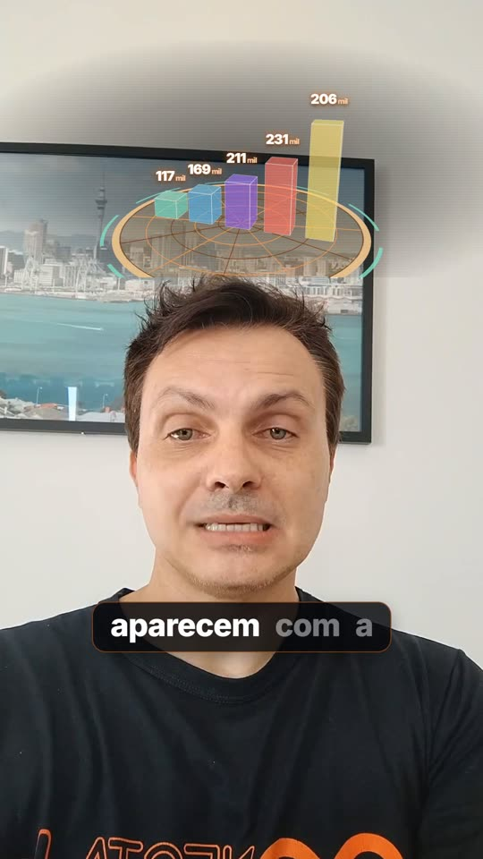
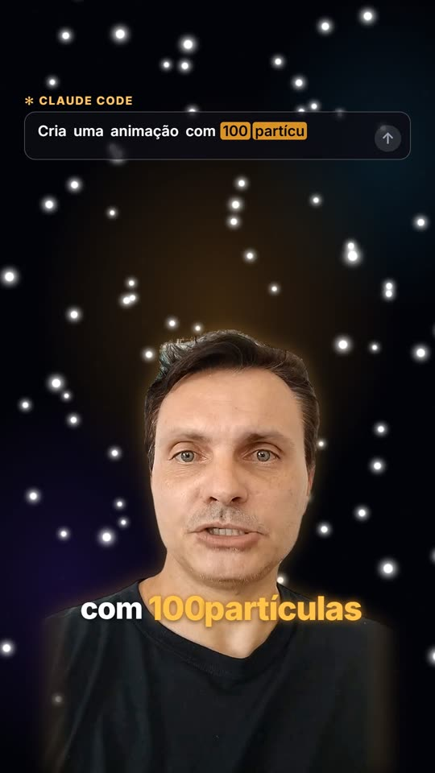
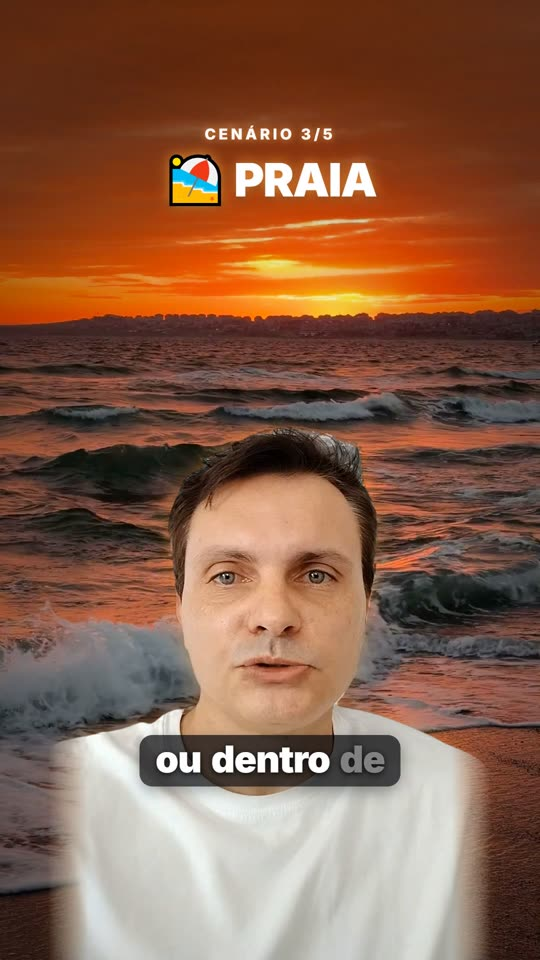
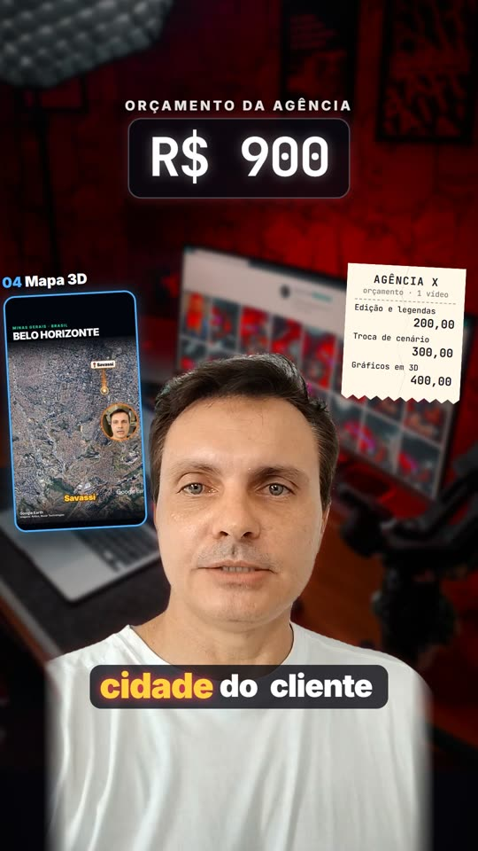
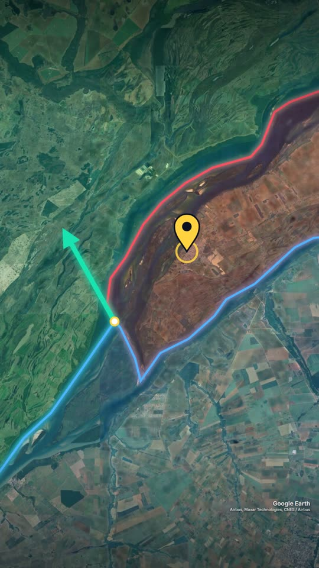
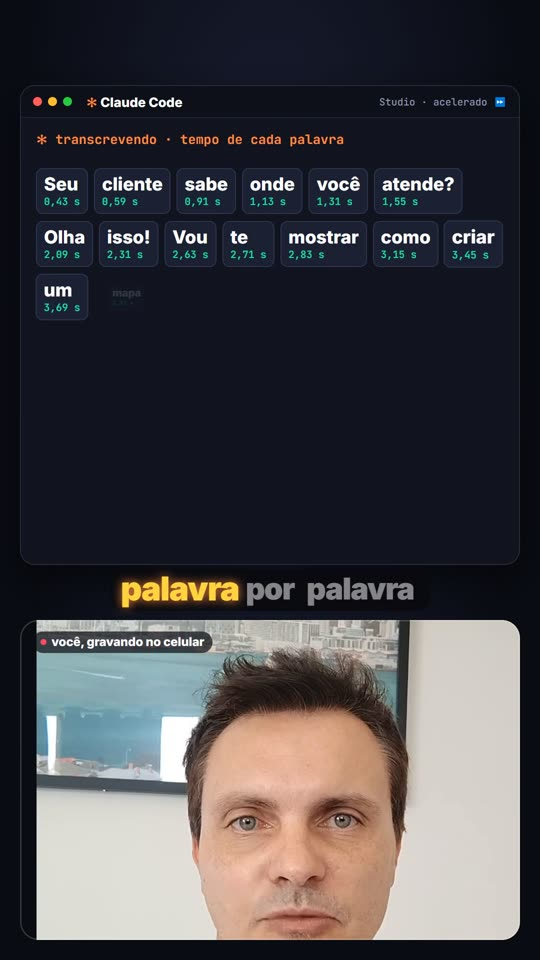
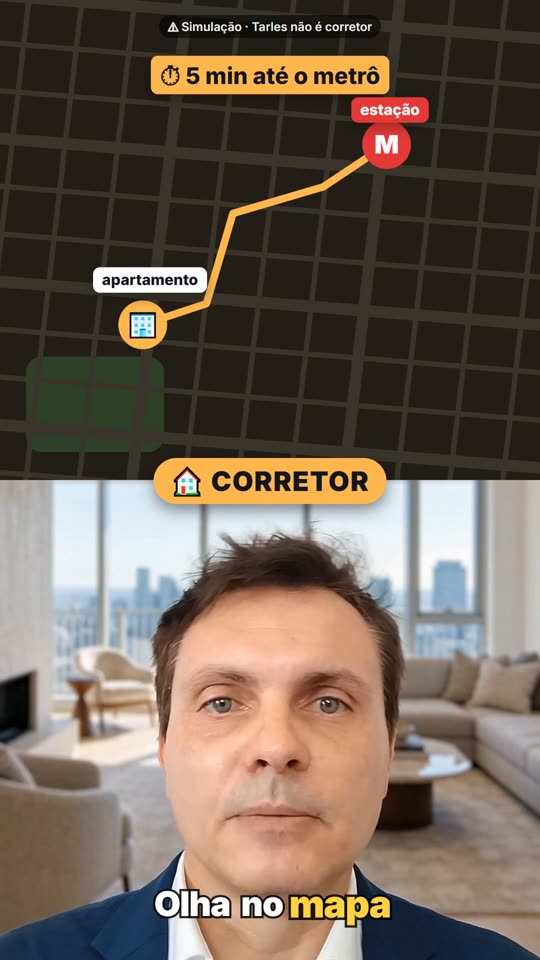
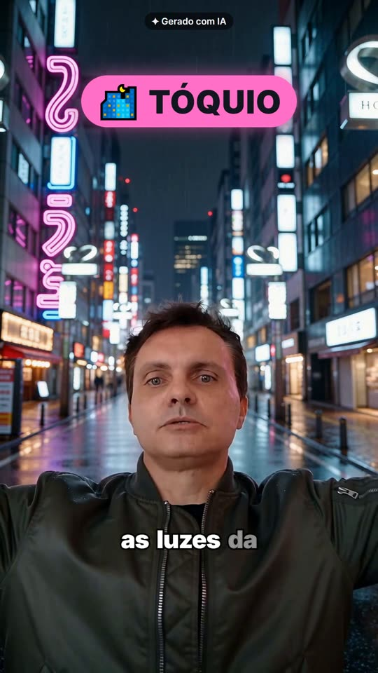
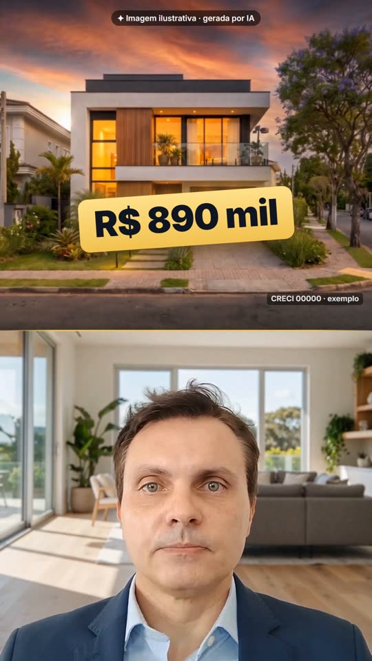

# Galeria de estilos

Referências para você escolher (ou misturar) antes de editar. **Nenhum estilo é obrigatório.** Diga ao Claude qual te agrada, peça variações ("o minimal suíço, mas com fundo escuro") ou traga as suas próprias referências: salve prints de vídeos, sites ou marcas que você admira em `prints/` e peça "segue o estilo destas imagens".

Na conversa, basta citar o nome do estilo em negrito.

---

## Exemplos que rodam no seu computador

Estes seis vêm com código em [src/estilos/](../src/estilos/). Abra `npm run studio` para vê-los em movimento. A silhueta cinza marca onde entra a **sua câmera**.

### Horizontal (16:9)

| | |
|---|---|
|  |  |
| **Minimal suíço.** Fundo branco, tipografia pesada, grade e um único vermelho. Tela dividida com a câmera à direita, entrando junto com o painel. Bom para aulas e passo a passo. | **Terminal técnico.** Fundo escuro com grade fina, fonte mono, texto digitado em tempo real, câmera em card com brilho. Bom para programação, IA e ferramentas. |
|  | |
| **Papel recortado leve.** Aula em papel creme nas cores do Claude: folhas com borda de tesoura, fita terracota, texto 3D de papel, câmera **colada** com borda branca e fita, e a variação **meia tela**. Peças prontas em `src/estilos/papel-recortado.tsx` e recriação do Claude Code em `src/estilos/claude-code.tsx`. Bom para aulas de IA e ferramentas. | |

### Vertical (9:16) para Reels, TikTok e Shorts

| | | |
|---|---|---|
|  |  |  |
| **Legenda dinâmica.** Câmera cheia, legenda grande palavra por palavra, a palavra falada em destaque. | **Print com marca-texto.** O print em cima dá zoom e o marca-texto passa sobre a frase citada; câmera embaixo. | **Dados leves.** Gradiente claro, número que conta até o valor falado, barras que crescem; câmera em círculo. |

---

## Estilos dos nossos vídeos (vertical, 9:16)

Quadros reais de vídeos feitos com este fluxo pelo Tarles Prado. São **um** jeito de fazer, não o padrão. Cenas de casas e de lugares foram geradas por IA; as de mapa usam o Google Earth Studio.

|  |  |  |
|---|---|---|
|  |  |  |
| **Gráficos animados.** Câmera em card no topo e gráficos que crescem junto com a fala. As etiquetas aparecem no momento em que a palavra é dita. | **Hologramas 3D.** Gráficos 3D flutuando sobre a cabeça, em estúdio escuro. A câmera gira devagar para dar profundidade. | **Universo de partículas.** Você recortado sobre um fundo animado de partículas; o texto aparece digitado, como num terminal. |

|  |  |  |
|---|---|---|
|  |  |  |
| **Cenários.** Você recortado sobre cenários reais (vídeos gratuitos do Pexels), com a etiqueta de cada lugar. | **Cards de prova e preço.** Cards com trechos de vídeos, nota fiscal que se escreve e etiquetas de preço que caem na fala. | **Mapa com divisas e setas.** Voo real do Google Earth Studio com contornos oficiais do IBGE e setas animadas. O crédito do Google Earth fica visível. |

|  |  |  |
|---|---|---|
|  |  |  |
| **Janela do Claude Code.** A tela do computador recriada em cima (conversa, plano, código) e você embaixo, num card. | **Tela dividida com animações.** Em cima, uma animação do assunto; embaixo, você com roupa e cenário trocados por IA (Higgsfield), com etiqueta e selo de simulação. | **Lugares com IA.** Tela cheia, com roupa e cenário trocados por IA e a etiqueta de cada lugar entrando com um flash. |

|  |
|---|
|  |
| **Imóvel.** Casa gerada por IA em cima, com etiquetas, mapa de "5 min" e preço caindo; você embaixo. Selo "imagem ilustrativa". |

---

## Como pedir um estilo

```text
Usa o estilo "terminal técnico", intensidade equilibrada.
```

```text
Mistura a "tela dividida com animações" com a legenda dinâmica, em vertical.
```

```text
Coloquei 3 prints do canal X em prints/referencia-*. Segue esse visual.
```
